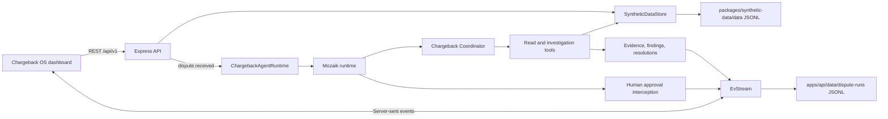

# Chargeback OS

Chargeback OS is an Agents in Finance project for investigating online payment disputes. It brings payment, order, fulfillment, customer communication, and policy records into one case view, then uses a Mozaik agent workflow to gather evidence and prepare a response for human review.

The project runs entirely on synthetic data. It does not connect to real customer accounts, move money, or submit responses to a payment provider. A reviewer can inspect the investigation timeline, evidence, findings, proposed response, and raw event output before making an approval decision.

## What it does

- Shows a finance operations dashboard with dispute volume, cases needing a response, and recent activity.
- Presents each dispute as a case, with linked customer, payment, order, product, shipment, communication, and policy details.
- Starts a model-backed investigation from a synthetic payment and cardholder claim.
- Streams participant activity, tool calls, evidence, findings, and response proposals to the case page.
- Pauses before a simulated provider response so a person can approve or reject it.
- Replays a previously captured investigation without an AI API key, when a saved run is available.

## Architecture



### Investigation flow

1. The user selects a synthetic payment and dispute reason, then describes the cardholder claim.
2. `POST /api/v1/disputes` creates an in-memory synthetic dispute and publishes a provider-neutral `chargeback.dispute.received` event.
3. `ChargebackAgentRuntime` forwards that event to Mozaik. The current API handler starts the **Chargeback Coordinator** agent loop.
4. The coordinator uses service-backed tools to load dispute, order, payment, fulfillment, and customer communication data. Investigation tools emit evidence, findings, evidence requests, and resolution proposals as events.
5. Mozaik lifecycle events and tool results are published through EvStream. The browser receives them over server-sent events and renders the live case timeline.
6. If the model requests the provider-submission tool, an interception pauses the loop and publishes an approval request. Approval resumes the loop; the provider adapter is simulated and never sends a real response.
7. Events are appended to a JSONL file so the run can be reviewed or replayed later.

The runtime registers six Mozaik agent identities with separate roles: coordinator, financial evidence, fulfillment evidence, customer policy, contradiction review, and resolution. The current API event handler automatically starts the coordinator; it does not yet dispatch every specialist as a separate agent loop. The role definitions and runtime are organized so that specialist dispatch can be added without changing the data package or API route structure.

### Agent package

[`packages/chargeback-agents`](packages/chargeback-agents) owns the Mozaik integration and domain contracts. It is divided into:

- `contracts/` — provider-neutral event, agent, tool, context, and repository types.
- `core/` — Mozaik runtime initialization, event dispatch, participant registration, and `runLoop` invocation.
- `adapters/` — provider event normalization and conversion into Mozaik semantic events.
- `agents/` — stable role IDs used by Chargeback OS.
- `tools/` — the controlled tool catalog used by the investigation runtime.

The API supplies tool implementations and runtime configuration. The agent package does not own provider SDKs, database access, or model credentials.

## Synthetic data

[`packages/synthetic-data`](packages/synthetic-data) is the shared source for the dashboard, API, and agent tools. It contains a deterministic generator, JSONL datasets, schemas, validators, and typed read-only collection classes.

- `data/source/*.jsonl` contains linked merchant, customer, address, product, order, payment, transaction, fulfillment, communication, policy, and dispute records.
- `data/investigation/*.jsonl` contains the investigation entity datasets.
- `data/evaluation/expected_outcomes.jsonl` is kept separate from normal source loading.
- `data/manifest.json` records the dataset version, seed, record counts, and file checksums.

The checked-in dataset is generated from a fixed seed and contains **2,397 synthetic source records** across 36 source collections, plus 15 evaluation outcomes. Generated identities and addresses use synthetic values such as `example.test`; provider and commerce systems are simulated.

`SyntheticDataStore` loads the JSONL files into typed in-memory collections. Collection queries support filtering, ordering, pagination, and relationship helpers such as `payments.forOrder`, `orders.forCustomer`, and `shipments.forOrder`. Returned records are cloned so consumers cannot mutate the shared source records. The API and tools query this same store rather than maintaining separate copies of the domain data.

Regenerate and validate the dataset with:

```bash
pnpm --filter @packages/synthetic-data generate
pnpm --filter @packages/synthetic-data validate
```

To extend the schema, update the relevant types and collection in `packages/synthetic-data/src`, update the generator in `packages/synthetic-data/scripts/generate.ts`, then run the commands above. The validator checks generated JSONL against the schema and dataset relationships.

## Run locally

### Requirements

- Node.js 20.19 or newer
- pnpm 10 or newer

No database is required for the synthetic dashboard or dispute workflow.

### Install and configure

Run these commands from the repository root:

```bash
pnpm install
cp .env.example .env
```

The repository-root `.env` is the single environment file for the API and frontend build. For a model-backed investigation, set `OPENAI_API_KEY`. Set `OPENAI_BASE_URL` when using an OpenAI-compatible endpoint, and set `MOZAIK_MODEL` to a model supported by that endpoint. The default model is `gpt-6-luna`.

`VITE_API_URL` is an optional **public** frontend build setting. Leave it empty for the default same-origin setup. Never put API keys or other secrets in a `VITE_` variable; Vite embeds those values in the browser bundle.

### Start the development servers

Terminal 1 — API:

```bash
pnpm --filter @apps/api dev
```

Terminal 2 — frontend:

```bash
pnpm --filter @apps/web dev
```

Open [http://localhost:5173](http://localhost:5173). The API listens on port `5000`; the Vite development server proxies `/api`, `/health`, and `/openapi.json` to it. To use another API port, set `PORT` and `API_PROXY_TARGET` in the root `.env`.

The dashboard and synthetic data browser work without model credentials. **Create dispute** starts the model-backed flow and requires `OPENAI_API_KEY`. **Run saved demo** replays a completed JSONL run without calling Mozaik or an AI provider.

This workspace already has saved dispute runs in `apps/api/data/dispute-runs/`. Each `<dispute-id>.jsonl` file contains the event history for one run. You can inspect a file directly, view its case in the frontend at `/disputes/<dispute-id>`, or fetch its event history from `GET /api/v1/disputes/<dispute-id>/run`. The **Run saved demo** action replays a completed saved run as a new case. Run files are runtime data and are ignored by Git, so include that directory in a deployment or fresh checkout when you want those saved runs available there.

### Build and run as one server

```bash
pnpm run build
pnpm --filter @apps/api start
```

The Vite production build is written to `apps/api/public`. Express serves the frontend at `/`, including client-side dashboard routes, and the API remains under `/api/v1`. The default `VITE_API_URL` is empty so browser requests use the same origin. Set it at build time only when deploying the API on a separate origin.

Useful checks:

```bash
pnpm run typecheck
pnpm run build
pnpm --filter @packages/chargeback-agents verify
```

## Main screens

- `/dashboard` — operational overview, recent disputes, and the investigation launcher.
- `/disputes` — dispute queue and response deadlines.
- `/disputes/simulate` — create a model-backed dispute or replay a saved run.
- `/disputes/:id` — case summary, evidence, findings, proposed response, approval, and live agent timeline.
- `/customers`, `/orders`, `/payments`, and `/products` — user-oriented linked details.
- `/policies` — available policy versions and dispute reason codes.

The frontend is a React application built with Vite, React Router, and shadcn components. Its API functions and React Query hooks live under `apps/web/src/core-api` and `apps/web/src/hooks/query`.

## API surface

The API is public and serves synthetic records. It uses Express, Zod request validation, OpenAPI DTOs, Pino logging, and the shared synthetic-data package. The complete schema is available at `/openapi.json`.

| Endpoint                                                  | Purpose                                                                         |
| --------------------------------------------------------- | ------------------------------------------------------------------------------- |
| `GET /api/v1/chargebacks`                               | Dashboard metrics and synthetic resource counts                                 |
| `GET /api/v1/chargebacks/disputes`                      | Search and list disputes                                                        |
| `GET /api/v1/chargebacks/disputes/:disputeId`           | Dispute with related payment and order context                                  |
| `GET /api/v1/:collection`                               | List a synthetic collection, with pagination                                    |
| `GET /api/v1/:collection/:recordId`                     | View one record from a synthetic collection                                     |
| `GET /api/v1/disputes/:recordId/overview`               | Case details and related customer, payment, order, policy, and fulfillment data |
| `GET /api/v1/disputes/:recordId/run`                    | Read one saved run's status and event history                                  |
| `POST /api/v1/disputes`                                 | Create a synthetic dispute and start an AI investigation; requires an API key   |
| `POST /api/v1/disputes/demo-runs`                       | Replay a saved investigation without an AI API key                              |
| `POST /api/v1/disputes/:recordId/approvals/:approvalId` | Approve or reject a pending simulated response                                  |
| `GET /api/v1/chargebacks/events/stream?disputeId=:id`   | Receive live investigation events using server-sent events                      |

Each synthetic collection has its own route folder under `apps/api/src/routes/` and its own list and detail endpoints. The generic collection notation in the table represents those individually implemented routes.

## Data and financial safety

- All case records and provider activity are synthetic. No real customer data or connected payment accounts are used.
- The provider response tool is simulated. No funds move and no provider submission occurs.
- A human approval is required before the simulated response action continues.
- Investigation summaries should be reviewed against the source records and event payloads shown in the case timeline. Chargeback OS is an operational review tool, not financial or legal advice.

## Repository map

```text
apps/
  api/                    Express API, Mozaik runtime integration, and saved run JSONL
  web/                    Vite + React dashboard
packages/
  chargeback-agents/      Mozaik runtime, agent roles, event contracts, and tool catalog
  synthetic-data/         Deterministic data generator, JSONL, schemas, and typed store
  config/                 Shared TypeScript and esbuild configuration
```
